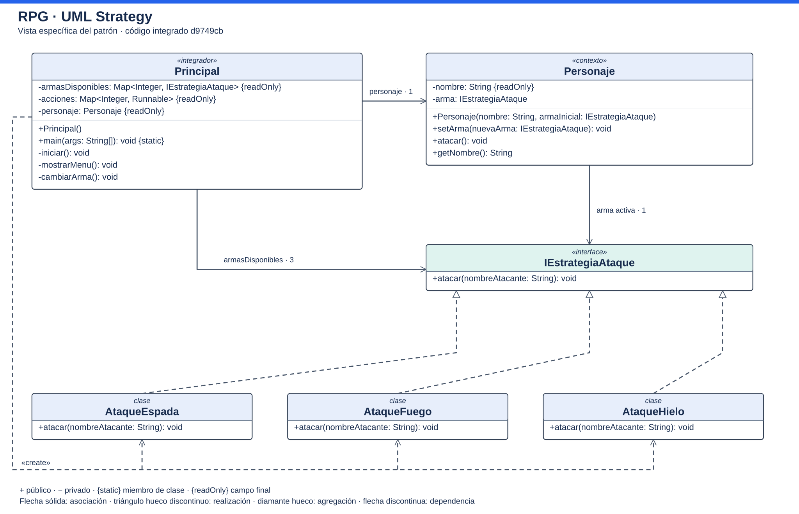
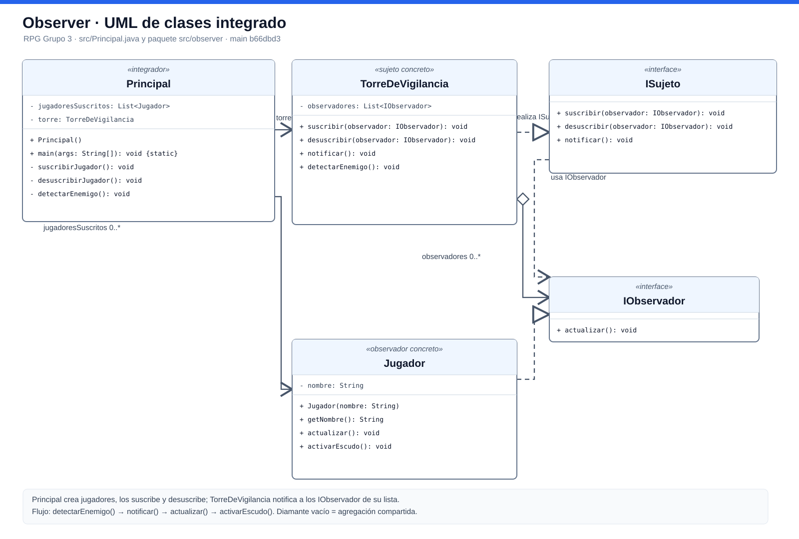

# Grupo 03 - Patrones de Comportamiento: Strategy y Observer

Exposicion grupal de **Aplicaciones Distribuidas**: simulador de videojuego RPG por consola en Java que demuestra los patrones de diseno **Strategy** y **Observer**.

---

## Integrantes

| Integrante | Rol |
|---|---|
| Steven Villegas | Teoria y Analisis (patron Strategy) |
| Miguel Flores | Teoria y Analisis (patron Observer) |
| Leonardo Figueroa | Analisis arquitectonico y diagramas UML |
| Jorge Yugsi | Desarrollo (patron Strategy) |
| Francisco Jimenez | Desarrollo (patron Observer) |
| Wendy Cueva | Desarrollo (configuracion, integracion y documentacion) |

---

## Escenario practico

El proyecto simula un videojuego RPG con dos mecanicas:

1. **Sistema de ataques (Strategy):** un `Personaje` puede atacar con distintas armas (espada, fuego, hielo). El arma se cambia **en tiempo de ejecucion** con `personaje.setArma(new AtaqueFuego())`, y el comportamiento de `atacar()` cambia **sin modificar la clase `Personaje`** y sin bloques `if-else` ni `switch`.

2. **Sistema de alertas (Observer):** una `TorreDeVigilancia` mantiene una lista de jugadores suscritos. Cuando se ejecuta `torre.detectarEnemigo()`, la torre recorre su lista y **todos los jugadores ejecutan automaticamente** su metodo `activarEscudo()`.

---

## Patrones aplicados

### Strategy

Define una familia de algoritmos, encapsula cada uno y los hace intercambiables.

| Rol del patron | Clase |
|---|---|
| Estrategia (abstraccion) | `IEstrategiaAtaque` |
| Estrategias concretas | `AtaqueEspada`, `AtaqueFuego`, `AtaqueHielo` |
| Contexto | `Personaje` |

`Personaje` recibe su estrategia por **inyeccion de dependencias** (constructor y `setArma()`) y delega en ella la accion de atacar.

### Observer

Define una dependencia uno a muchos: cuando el sujeto cambia de estado, notifica automaticamente a todos sus observadores.

| Rol del patron | Clase |
|---|---|
| Sujeto (abstraccion) | `ISujeto` |
| Sujeto concreto | `TorreDeVigilancia` |
| Observador (abstraccion) | `IObservador` |
| Observador concreto | `Jugador` |

La torre solo conoce la interfaz `IObservador`, no la clase `Jugador`, por lo que se pueden agregar nuevos tipos de observadores sin modificarla.

### Principios SOLID

- **DIP (Inversion de dependencias):** `Personaje` depende de `IEstrategiaAtaque` y `TorreDeVigilancia` depende de `IObservador`; ninguno depende de clases concretas.
- **OCP (Abierto/Cerrado):** para agregar un arma nueva o un nuevo tipo de observador se crea una clase nueva, sin modificar las existentes.
- **SRP (Responsabilidad unica):** cada clase tiene una sola responsabilidad (cada ataque, el personaje, la torre, el jugador y el menu de `Principal`).

---

## Diagrama UML

### Patron Strategy



### Patron Observer



Las fuentes editables (`.puml`) y la documentacion de los diagramas estan en la carpeta `docs/uml/`.

---

## Estructura del proyecto

```
Grupo03-PatronesComportamiento/
├── src/
│   ├── Principal.java              # Menu interactivo de la simulacion
│   ├── strategy/
│   │   ├── IEstrategiaAtaque.java
│   │   ├── AtaqueEspada.java
│   │   ├── AtaqueFuego.java
│   │   ├── AtaqueHielo.java
│   │   └── Personaje.java
│   └── observer/
│       ├── ISujeto.java
│       ├── IObservador.java
│       ├── TorreDeVigilancia.java
│       └── Jugador.java
├── docs/
│   ├── strategy.md                 # Fundamentos teoricos de Strategy
│   ├── arquitectura/               # Analisis arquitectonico y guion de exposicion
│   └── uml/                        # Diagramas UML (.svg) y sus fuentes (.puml)
├── .gitignore
└── README.md
```

---

## Requisitos

- **JDK 21**
- **IntelliJ IDEA** (opcional, tambien se puede ejecutar desde la terminal)
- **Git**

---

## Compilar y ejecutar

### Opcion 1: IntelliJ IDEA

1. Clonar el repositorio:
   ```bash
   git clone https://github.com/30621-srvillegas/Grupo03-PatronesComportamiento.git
   ```
2. En IntelliJ: **File > Open** y seleccionar la carpeta `Grupo03-PatronesComportamiento`.
3. Verificar el JDK en **File > Project Structure > Project > SDK: 21**.
4. Abrir `src/Principal.java` y presionar **Run** (boton verde junto al metodo `main`).

### Opcion 2: Terminal

Desde la raiz del proyecto:

```bash
javac -encoding UTF-8 -d out -sourcepath src src/Principal.java
java -cp out Principal
```

`-sourcepath src` hace que `javac` compile automaticamente las clases de los paquetes `strategy` y `observer` que usa `Principal`.

---

## Uso de la simulacion

Al ejecutar se muestra un menu interactivo por consola:

```
=== Simulador RPG: Patrones Strategy y Observer ===

------ STRATEGY ------
1. Atacar
2. Cambiar arma
------ OBSERVER ------
3. Suscribir jugador a la torre
4. Desuscribir jugador
5. Detectar enemigo
0. Salir
Elige una opcion:
```

**Demostracion de Strategy:** opcion `1` (ataca con espada), opcion `2` y elegir `AtaqueFuego`, y otra vez opcion `1`: el mismo metodo `atacar()` produce un resultado distinto.

**Demostracion de Observer:** opcion `3` para suscribir varios jugadores y opcion `5` para detectar un enemigo:

```
Torre: enemigo detectado
Jorge: escudo activado
Pancho: escudo activado
```

Con la opcion `4` se desuscribe un jugador, y al detectar otro enemigo ese jugador ya no recibe la alerta.

---

## Flujo de trabajo en Git

Cada pieza se desarrollo en una rama independiente y se integro a `main` mediante Pull Requests:

| Rama | Contenido |
|---|---|
| `chore/configuracion-inicial` | Proyecto base y `.gitignore` |
| `feature/strategy-ataque` | Patron Strategy |
| `feature/observer-alerta` | Patron Observer |
| `feature/principal-integracion` | Menu interactivo en `Principal` |
| `docs/01-fundamentos-strategy` | Fundamentos teoricos de Strategy |
| `docs/est-07-diagramas-uml` | Diagramas UML de Strategy y Observer |
| `docs/est-08-analisis-arquitectura` | Analisis arquitectonico y principios SOLID |
| `docs/readme` | Documentacion del proyecto |

Las tareas se gestionaron en un tablero Kanban de **GitHub Projects**.
