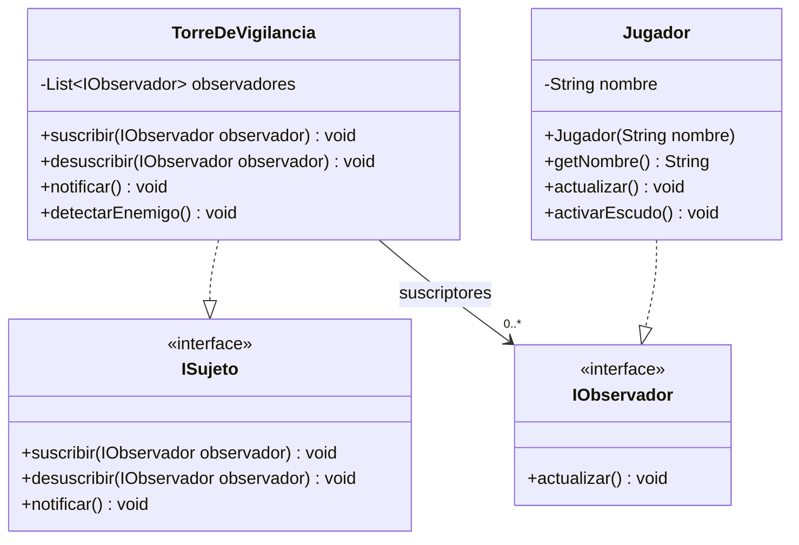

# Observer en el videojuego RPG

## Caso de uso

Cuando aparece un enemigo, la torre de vigilancia avisa a los jugadores que se suscribieron a sus alertas. Quien abandona la vigilancia puede desuscribirse y deja de recibir avisos. Una misma detección puede activar la reacción de varios jugadores.

La torre conserva una lista de `IObservador`. Para avisarles llama a `actualizar()` en cada uno. El jugador decide cómo responder a esa llamada y, en este caso, ejecuta `activarEscudo()`. Así se mantiene separada la distribución de la alerta de la reacción de cada jugador.

## Clases y responsabilidades

| Elemento | Rol | Responsabilidad |
| --- | --- | --- |
| `ISujeto` | Contrato del sujeto | Declara las operaciones para suscribir, desuscribir y notificar observadores. |
| `TorreDeVigilancia` | Sujeto concreto | Gestiona las suscripciones y emite la alerta al detectar un enemigo. |
| `IObservador` | Contrato del observador | Define la operación `actualizar()` que recibe cada suscriptor. |
| `Jugador` | Observador concreto | Conserva el nombre del jugador y activa su escudo al recibir una alerta. La activación se representa con un mensaje en consola. |
| `Principal` | Menú de la simulación | Crea los jugadores, permite elegir a quién desuscribir y llama a la torre según la opción seleccionada. |

## Flujo de la alerta

1. **Suscripción (opción 3).** El usuario escribe el nombre de un jugador. `Principal` crea el objeto y llama a `torre.suscribir(jugador)` para registrarlo.
2. **Detección (opción 5).** `Principal` invoca `torre.detectarEnemigo()`. La torre imprime el aviso y llama a `notificar()`.
3. **Notificación.** `notificar()` recorre una copia de la lista de suscriptores y llama a `actualizar()` en cada uno. En `Jugador`, ese método llama a `activarEscudo()`, que informa de la activación en consola. Las llamadas se ejecutan de forma síncrona en la misma ejecución del menú.
4. **Desuscripción (opción 4).** El usuario elige a un jugador de la lista. `Principal` lo retira de su lista del menú y llama a `torre.desuscribir(jugador)`. En la siguiente detección, solo reciben el aviso quienes siguen suscritos.

## Esquema de clases para revisión

El esquema refleja las clases y operaciones que usa el mecanismo de alertas. La relación con multiplicidad `0..*` indica que la torre puede tener cero o varios observadores.

## Comprobación en consola

| Secuencia probada | Resultado observado |
| --- | --- |
| Suscribir a Aria y Bruno con la opción 3. Detectar un enemigo con la opción 5. | La torre imprime el aviso y ambos jugadores activan su escudo. |
| Desuscribir a Aria con la opción 4. Detectar otro enemigo con la opción 5. | Solo Bruno activa su escudo. |
| Iniciar la aplicación y detectar un enemigo sin suscribir jugadores. | La torre imprime el aviso sin mensajes de activación de escudo. |

Implementación de referencia. [Menú de la simulación](../src/Principal.java) · [Clases de Observer](../src/observer/)
