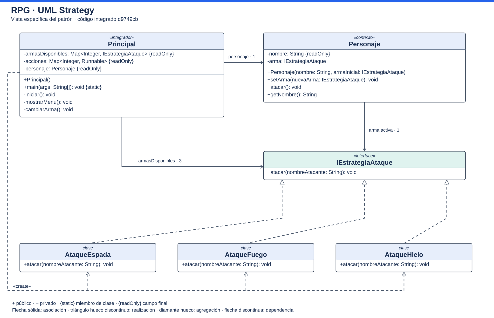
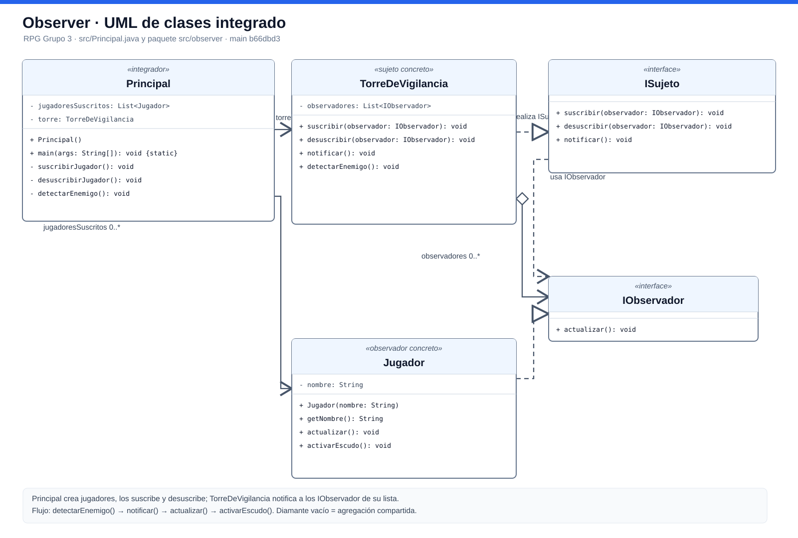

# Strategy y Observer
## Patrones de comportamiento en un videojuego RPG

**Grupo 03 · Aplicaciones Distribuidas · ESPE**

**Equipo:** Steven Villegas · Miguel Flores · Leonardo Figueroa · Jorge Yugsi · Francisco Jiménez · Wendy Cueva

> **Base de código:** `main`, revisión `b66dbd3`. Las imágenes de UML corresponden a EST-07 (PR #34) y el análisis a EST-08 (PR #35).

---

# Objetivo y distribución de funciones
**Demostrar ambos patrones con arquitectura comprensible y ejecución real.**

| Teoría y analogías | Arquitectura y UML | Desarrollo / demostración |
|---|---|---|
| Steven: Strategy | Leonardo: UML, SOLID, condicionales | Jorge: cambio de arma |
| Miguel: Observer | Leonardo: relaciones y desacoplamiento | Francisco: notificaciones |
| | | Wendy: integración, menú y README |

**Recorrido:** concepto → estructura UML → `Principal.java` → demostración → conclusiones.

---

# Strategy — idea central
**Responsable de exposición: Steven**

- Define una familia de comportamientos y los encapsula en clases intercambiables.
- El **contexto** depende de una **interfaz**, no de todas las implementaciones.
- Cambiar la estrategia no requiere alterar `Personaje.atacar()`.

**Analogía:** elegir entre auto, bus o bicicleta según las condiciones; el objetivo del desplazamiento es el mismo, cambia la manera de lograrlo.

**En el RPG:** espada, fuego e hielo son estrategias de ataque.

---

# Strategy — del concepto al RPG
**Responsable: Steven**

- `IEstrategiaAtaque.atacar(String nombreAtacante)`: contrato.
- `AtaqueEspada`, `AtaqueFuego`, `AtaqueHielo`: comportamientos concretos.
- `Personaje`: conserva `arma: IEstrategiaAtaque`.
- `Principal`: crea y selecciona las instancias desde `armasDisponibles`.

**Ejemplo comprobable:**
```java
personaje.atacar();
personaje.setArma(armaElegida);
personaje.atacar();
```

> El menú valida opciones; no se afirma que todos los condicionales desaparezcan.

---

# Observer — idea central
**Responsable: Miguel**

- Un **sujeto** conserva una colección de observadores interesados.
- Los interesados pueden suscribirse y desuscribirse.
- Cuando ocurre el evento, el sujeto invoca un contrato común: `actualizar()`.

**Analogía:** usuarios suscritos a un canal reciben una notificación cuando aparece un video nuevo.

**En el RPG:** una torre detecta enemigos y alerta a los jugadores suscritos.

---

# Observer — secuencia real en el RPG
**Responsable: Miguel**

```text
Principal crea Jugador
      │
      ▼
torre.suscribir(jugador)
      │
      ▼
torre.detectarEnemigo()
      │
      ▼
torre.notificar()
      │
      ▼
IObservador.actualizar()
      │
      ▼
Jugador.activarEscudo()
```

**Nota:** notificaciones **síncronas y locales**, no mensajería distribuida.

---

# UML Strategy — arquitectura definitiva
**Responsable: Leonardo**



- `Principal` actúa como integrador.
- `Personaje` es el contexto del patrón.
- La línea de realización apunta a `IEstrategiaAtaque`.
- `setArma()` cambia la estrategia; `atacar()` delega.

**Archivo editable:** `docs/uml/strategy.puml`.

---

# UML Observer — arquitectura definitiva
**Responsable: Leonardo**



- `TorreDeVigilancia` realiza `ISujeto`.
- `Jugador` realiza `IObservador`.
- La torre almacena `List<IObservador>` (0..*).
- `Principal` guarda **otra** colección `List<Jugador>` para administrar el menú.

**Archivo editable:** `docs/uml/observer.puml`.

---

# Condicionales y principios SOLID
**Responsable: Leonardo**

| Elemento | Antes: alternativa rígida (hipotética) | Código integrado |
|---|---|---|
| Ataques | `if/switch` de ataques en `Personaje` | Delegación polimórfica a `IEstrategiaAtaque` |
| Alertas | Llamadas a cada `Jugador` concreto | `List<IObservador>` y `notificar()` |
| Menú | `switch` de opciones | `Map<Integer, Runnable>` y `getOrDefault` |

**OCP:** agregar una nueva implementación no requiere editar el núcleo del patrón.

**DIP:** `Personaje` y `TorreDeVigilancia` trabajan con interfaces.

**Límite:** `Principal` conoce las clases concretas al construirlas y mantiene validaciones legítimas.

---

# Live Coding — Strategy
**Responsable: Jorge**

1. Ejecutar `Principal.java`.
2. Opción **1**: atacar con la espada inicial.
3. Opción **2**: cambiar a `AtaqueFuego` (número 2).
4. Opción **1**: atacar otra vez.
5. Repetir con `AtaqueHielo` (número 3), si el tiempo lo permite.

**Evidencia:** mismo `Personaje.atacar()`, salida diferente; estrategia sustituida mediante `setArma()`.

**Método clave:** `arma.atacar(nombre)`.

---

# Live Coding — Observer
**Responsable: Francisco**

1. Opción **3**: suscribir dos jugadores, por ejemplo «Jorge» y «Pancho».
2. Opción **5**: detectar un enemigo; ambos activan el escudo.
3. Opción **4**: desuscribir uno de los jugadores.
4. Opción **5**: detectar de nuevo; solo recibe la alerta el jugador restante.

**Evidencia:** el sujeto usa `actualizar()` sin llamar a `Jugador.activarEscudo()` directamente.

---

# Integración y ejecución
**Responsable: Wendy**

**Requisito:** JDK 21. Desde la raíz del repositorio:

```bash
javac -encoding UTF-8 -d out -sourcepath src src/Principal.java
java -cp out Principal
```

**Menú interactivo:**

| Opción | Función |
|---|---|
| 1 / 2 | Atacar / cambiar arma |
| 3 / 4 / 5 | Suscribir / desuscribir / detectar enemigo |
| 0 | Salir |

El `README.md` reúne roles, patrones, imágenes UML, estructura del proyecto e instrucciones.

---

# ¿Dónde se usan fuera de los videojuegos?
**Steven y Miguel (cierre de teoría)**

**Strategy:** aplicación de comercio electrónico con modalidades de cálculo de envío: estándar, urgente y retiro.

**Observer:** cambios de estado de un pedido que notifican a componentes de seguimiento, auditoría o correo.

**Equivalencia arquitectónica:**
- Contexto ↔ `Personaje`; estrategias ↔ tipos de ataque.
- Sujeto ↔ `TorreDeVigilancia`; observadores ↔ jugadores suscritos.

> Son ejemplos de uso, no funcionalidades existentes en el código Java del grupo.

---

# Conclusiones y preguntas
**Cierre: Wendy, con participación de los seis integrantes**

- **Strategy:** cambia algoritmos mediante composición y polimorfismo.
- **Observer:** distribuye alertas a suscriptores sin acoplar al emisor a sus clases.
- **OCP / DIP:** extensibilidad y dependencias orientadas a interfaces en el núcleo.
- **Validación:** clases y contratos contrastados con `main`; demostración desde `Principal.java`.

**Enlaces del trabajo:**
- Código y README: `main`.
- UML: PR #34, `docs/uml/`.
- Análisis: PR #35, `docs/arquitectura/`.

**Preguntas del docente: responder sin leer diapositivas.**
