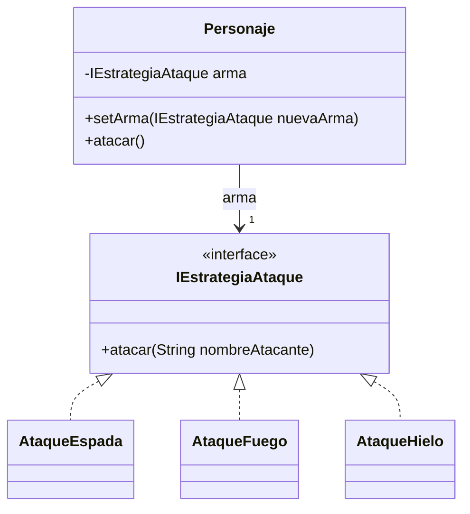

# Patrón Strategy

## Qué es y qué problema resuelve

El patrón Strategy, o Estrategia, es un patrón de diseño de comportamiento que permite definir distintas formas de realizar una misma tarea. Cada alternativa se implementa por separado y puede utilizarse en lugar de otra porque todas ofrecen la misma operación. De esta manera, el objeto que necesita realizar la tarea puede trabajar con la estrategia que corresponda sin conocer los detalles de su implementación (Gamma et al., 1995).

Pensemos en una aplicación que calcula rutas para auto, bus y bicicleta. Si una sola clase contiene las reglas de los tres casos, cada vez que agreguemos un medio de transporte tendremos que modificar esa clase. Además, será más difícil ubicar qué parte del código corresponde a cada recorrido. Con Strategy, las reglas de cada medio se pueden implementar de manera independiente y la aplicación puede seguir solicitando el cálculo de la ruta de la misma forma (Refactoring Guru, s. f.).

## Cómo funciona

El objeto que necesita realizar la tarea se conoce como **contexto**. Este guarda una referencia a la estrategia activa y le encarga la operación cuando la necesita. La **interfaz de estrategia** indica qué operación deben ofrecer todas las alternativas. Por ejemplo, cada **estrategia concreta** puede implementar `calcularRuta()` con reglas propias. La estrategia para auto puede tener en cuenta las vías habilitadas para vehículos y la de bus puede utilizar las paradas disponibles (Refactoring Guru, s. f.).

La elección de la estrategia puede depender del usuario o de una regla de la aplicación. Si el usuario selecciona primero el auto y luego cambia a bicicleta, la aplicación puede reemplazar la estrategia activa mientras está funcionando. En la siguiente solicitud, el contexto vuelve a llamar a `calcularRuta()`, y esta vez se aplican las reglas de la bicicleta. Esto es posible porque las dos estrategias ofrecen la misma operación (Refactoring Guru, s. f.).

## Analogía con los medios de transporte

Cuando queremos llegar a la universidad, podemos ir en auto, tomar un bus o usar la bicicleta. La elección depende de las condiciones del momento. Por ejemplo, si hay mucho tráfico y el recorrido es corto, podemos optar por la bicicleta. Si el trayecto es más largo y hay una línea directa, podemos tomar el bus. En ambos casos queremos llegar al mismo lugar y la decisión cambia la forma de hacerlo.

En la aplicación, el destino representa la parte de la solicitud que se conserva. El medio elegido determina qué estrategia calcula el recorrido. Por eso podemos usar el mismo destino y obtener rutas distintas al cambiar de medio de transporte. Esta analogía adapta el ejemplo de navegación presentado por Refactoring Guru (s. f.).

## Cuándo conviene usarlo

Strategy resulta útil cuando ya existen varias formas de realizar una tarea y necesitamos elegir entre ellas según las condiciones del momento. También facilita añadir una alternativa cuando el sistema crece. Por ejemplo, si más adelante incorporamos una ruta a pie, podemos implementar sus reglas en una nueva estrategia que respete la interfaz existente. La aplicación deberá ofrecer esa opción al usuario, pero el contexto podrá seguir solicitando el cálculo con la misma operación (Refactoring Guru, s. f.).

Cada estrategia agrega una implementación que debemos mantener. Si la tarea tiene una sola variante o las diferencias entre alternativas son pequeñas y estables, una solución directa puede ser suficiente (Refactoring Guru, s. f.).


## Strategy en el videojuego RPG

Imaginemos que el personaje empieza un combate con una espada. Más adelante decide lanzar un ataque de fuego. En ambos momentos, la acción que pedimos al personaje es la misma, `atacar()`. Lo que cambia es el objeto al que el personaje le encarga el ataque. En el RPG del grupo, `Personaje` guarda ese objeto en el atributo `arma`, cuyo tipo es `IEstrategiaAtaque` (Grupo 3, s. f.).

### Quién interviene en el ataque

| Elemento del RPG | Papel en el patrón | Qué hace |
| --- | --- | --- |
| `Principal` | Cliente del patrón | Crea las armas disponibles, recibe la selección del menú y se la pasa al personaje. |
| `Personaje` | Contexto | Guarda el arma activa y, al atacar, llama a `arma.atacar(nombre)`. |
| `IEstrategiaAtaque` | Interfaz de estrategia | Define la operación `atacar(String nombreAtacante)` que ofrecen las variantes. |
| `AtaqueEspada`, `AtaqueFuego` y `AtaqueHielo` | Estrategias concretas | Implementan el ataque con espada, fuego o hielo y muestran su resultado en consola. |

El siguiente diagrama muestra la relación entre las clases que participan directamente en el ataque. La selección del menú se realiza en `Principal`, que actúa como cliente del patrón. `Personaje` mantiene una referencia a la interfaz y cada estrategia concreta la implementa (Grupo 3, s. f.).



### Qué ocurre al cambiar de arma

Podemos seguir el cambio con dos ataques de Arthas, el personaje que utiliza la aplicación. El siguiente fragmento resume las llamadas que permiten pasar de espada a fuego (Grupo 3, s. f.).

```java
Personaje personaje = new Personaje("Arthas", new AtaqueEspada());
personaje.atacar();

personaje.setArma(new AtaqueFuego());
personaje.atacar();
```

| Paso | Qué ocurre |
| --- | --- |
| **Primer ataque** | El personaje empieza con `AtaqueEspada`. La primera llamada a `atacar()` invoca esa estrategia y la consola indica un ataque de espada con 20 puntos de daño físico. |
| **Cambio de arma** | `setArma()` reemplaza la referencia guardada por una instancia de `AtaqueFuego` y muestra el cambio en consola. El ataque de fuego se ejecuta en la siguiente llamada a `atacar()`. |
| **Segundo ataque** | El mismo personaje delega el ataque a `AtaqueFuego`. La consola indica que se lanzó una bola de fuego con 30 puntos de daño por quemadura. |

En `Principal.java`, las tres estrategias se crean al iniciar la aplicación y se guardan en `armasDisponibles`. Arthas recibe la espada como arma inicial. Cuando elegimos otra arma, `cambiarArma()` recupera el objeto correspondiente y llama a `personaje.setArma(armaElegida)`. Por eso el fragmento anterior permite explicar el cambio mediante una instancia nueva de fuego, mientras que el menú utiliza la instancia que ya guardó al iniciar (Grupo 3, s. f.).

| Selección en el menú | Resultado |
| --- | --- |
| **1. Atacar** | Arthas ejecuta el ataque de espada que recibió al crearse. |
| **2. Cambiar arma**, seguido de **2. AtaqueFuego** | El personaje equipa la estrategia de fuego. |
| **1. Atacar** | Arthas ejecuta el ataque de fuego con la estrategia seleccionada. |

Los valores de daño forman parte de los mensajes de la demostración. En estas estrategias, el comportamiento mostrado consiste en imprimir el resultado en consola (Grupo 3, s. f.).

### Por qué se mantiene la misma clase `Personaje`

En Java, una variable cuyo tipo es una interfaz puede guardar una referencia a cualquier objeto cuya clase implemente esa interfaz (Dev.java, 2021). Por eso `arma` puede guardar primero una instancia de `AtaqueEspada` y después una de `AtaqueFuego`. La llamada `arma.atacar(nombre)` se conserva porque ambas clases ofrecen la misma operación.

Si queremos equipar `AtaqueHielo`, podemos pasarlo a `setArma()` siguiendo el mismo procedimiento. De esta manera, el código que controla al personaje elige el ataque y cada estrategia se encarga de su propio comportamiento. Esa separación permite añadir nuevas formas de atacar sin modificar la lógica de `Personaje.atacar()` (Refactoring Guru, s. f.).

## Referencias

- Dev.java. (2021, 14 de septiembre). *Using an interface as a type*. [https://dev.java/learn/language/oop/interfaces/interfaces-as-a-type/](https://dev.java/learn/language/oop/interfaces/interfaces-as-a-type/)
- Gamma, E., Helm, R., Johnson, R., & Vlissides, J. (1995). *Design patterns: Elements of reusable object-oriented software*. Addison-Wesley. [Ficha editorial e índice](https://www.informit.com/store/design-patterns-elements-of-reusable-object-oriented-9780321770462)
- Grupo 3. (s. f.). *Implementación de Strategy en el videojuego RPG* [Código fuente, versión `b66dbd3`]. GitHub. [Clases del paquete `strategy`](https://github.com/30621-srvillegas/Grupo03-PatronesComportamiento/tree/b66dbd3c9659dc4188bf502ef1b2c149dfb15541/src/strategy) y [menú de `Principal.java`](https://github.com/30621-srvillegas/Grupo03-PatronesComportamiento/blob/b66dbd3c9659dc4188bf502ef1b2c149dfb15541/src/Principal.java)
- Refactoring Guru. (s. f.). *Strategy*. [https://refactoring.guru/es/design-patterns/strategy](https://refactoring.guru/es/design-patterns/strategy)
