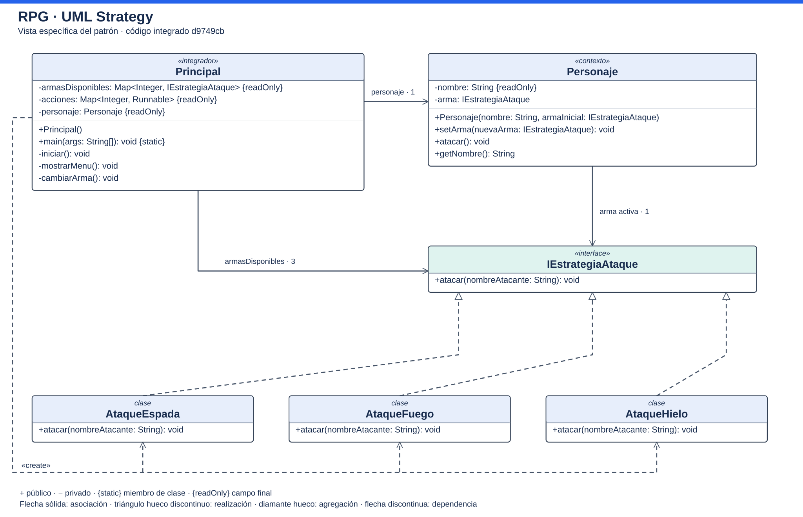
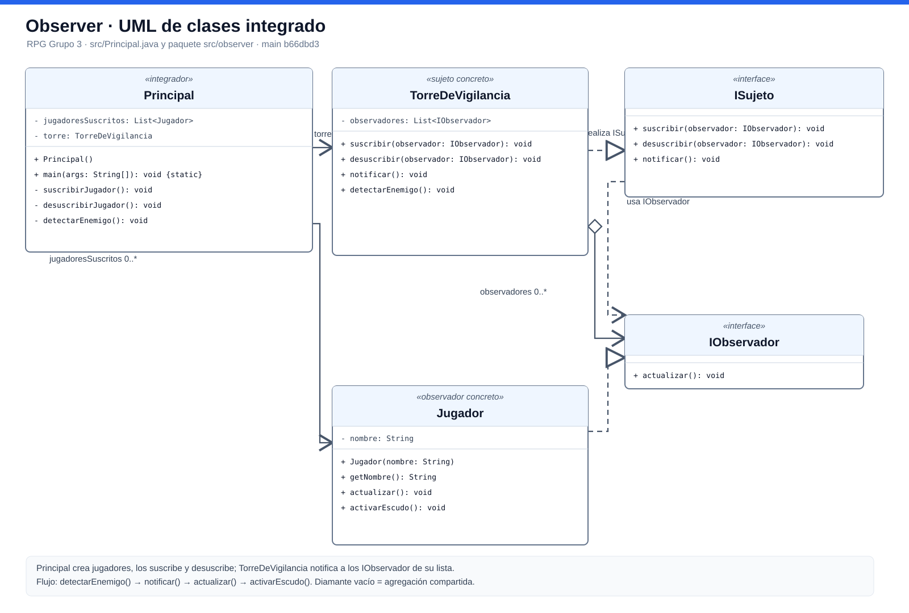

# EST-07 — Diagramas UML definitivos de Strategy y Observer

**Responsable:** Leonardo Figueroa (`@30621-lmfigueroa1`)  
**Rol:** Teoría y análisis arquitectónico, sin modificación de código Java.  
**Base de validación:** `main` en commit `b66dbd3c9659dc4188bf502ef1b2c149dfb15541` (19 de noviembre de 2026).

## Entregables

| Patrón | Imagen vectorial para exposición / README | Fuente editable PlantUML |
|---|---|---|
| Strategy | [strategy.svg](strategy.svg) | [strategy.puml](strategy.puml) |
| Observer | [observer.svg](observer.svg) | [observer.puml](observer.puml) |

## Strategy: diagrama final integrado

Se representan las clases implementadas: `Principal`, `Personaje`, `IEstrategiaAtaque`, `AtaqueEspada`, `AtaqueFuego` y `AtaqueHielo`.

- `Personaje` es el **contexto**; mantiene `arma: IEstrategiaAtaque` y delega `atacar()` mediante `arma.atacar(nombre)`.
- Las tres estrategias concretas **realizan** la interfaz `IEstrategiaAtaque`; la flecha de realización es una línea discontinua con triángulo hueco hacia la interfaz.
- `Principal` contiene `personaje: Personaje`, `armasDisponibles: Map<Integer, IEstrategiaAtaque>` y `acciones: Map<Integer, Runnable>`. Inicializa las tres estrategias concretas en su constructor y cambia el arma a través de `cambiarArma()` y `personaje.setArma(armaElegida)`.
- Las líneas sólidas con navegabilidad representan las **asociaciones** de los campos, no herencia: `Principal → Personaje`, `Principal → IEstrategiaAtaque` a través de los valores del mapa y `Personaje → IEstrategiaAtaque`.

La creación de `AtaqueEspada`, `AtaqueFuego` y `AtaqueHielo` por `Principal` se documenta en la nota del diagrama. El alcance es un UML de clases de la mecánica; no se representan todas las dependencias de bibliotecas Java.

## Observer: diagrama final integrado

Se representan `Principal`, `ISujeto`, `IObservador`, `TorreDeVigilancia` y `Jugador`.

- `TorreDeVigilancia` **realiza** `ISujeto`, mantiene `observadores: List<IObservador>` y conserva una **agregación compartida 1 a 0..***: guarda referencias sin controlar el ciclo de vida de los observadores.
- `Jugador` **realiza** `IObservador`, define `actualizar()` y en esa operación invoca `activarEscudo()`.
- `ISujeto` **depende de** `IObservador` porque sus métodos de suscripción y desuscripción reciben esa interfaz como parámetro.
- `Principal` mantiene `torre: TorreDeVigilancia` y `jugadoresSuscritos: List<Jugador>`, crea los jugadores, los suscribe o desuscribe, y llama `torre.detectarEnemigo()`.
- Flujo comprobado: `detectarEnemigo() → notificar() → actualizar() → activarEscudo()`. La torre itera sobre una copia temporal de la lista de observadores.

**Aclaración importante:** la agregación `TorreDeVigilancia → IObservador` corresponde al registro en la torre y es diferente de la asociación `Principal → Jugador`, que existe para seleccionar qué jugador desuscribir desde el menú.

## Verificación frente al código Java completo

Las clases y las firmas del núcleo Strategy/Observer en `main` coinciden con las utilizadas para elaborar los UML iniciales, pero el programa ahora también contiene un **menú interactivo integrado en `Principal`**, que no aparecía en los diagramas anteriores. Por ello se actualizaron las fuentes `.puml`, las imágenes `.svg` y esta explicación.

| Archivo Java en main | Comprobación en los UML |
|---|---|
| [`Principal.java`](../../src/Principal.java) | Instancia `Personaje` y `TorreDeVigilancia`; administra `Map<Integer, IEstrategiaAtaque>`, `Map<Integer, Runnable>` y `List<Jugador>`; métodos de interacción por menú. |
| [`strategy/Personaje.java`](../../src/strategy/Personaje.java) | Constructor, `setArma`, `atacar`, `getNombre` y relación con `IEstrategiaAtaque`. |
| [`strategy/IEstrategiaAtaque.java`](../../src/strategy/IEstrategiaAtaque.java) | Método `atacar(String nombreAtacante)`. |
| [`strategy/AtaqueEspada.java`](../../src/strategy/AtaqueEspada.java), [`AtaqueFuego.java`](../../src/strategy/AtaqueFuego.java) y [`AtaqueHielo.java`](../../src/strategy/AtaqueHielo.java) | Implementaciones concretas y firmas correctas. |
| [`observer/ISujeto.java`](../../src/observer/ISujeto.java) y [`IObservador.java`](../../src/observer/IObservador.java) | Contratos de suscripción/notificación y actualización. |
| [`observer/TorreDeVigilancia.java`](../../src/observer/TorreDeVigilancia.java) | `List<IObservador>`, suscripción, desuscripción, notificación y detección. |
| [`observer/Jugador.java`](../../src/observer/Jugador.java) | `nombre`, constructor, `getNombre()`, `actualizar()` y `activarEscudo()`. |

Los enlaces relativos a archivos `src` funcionan después de integrar este PR con `main`, ya que las ramas de documentación nacieron antes de que se incorporara el código definitivo.

## Estado de la revisión

- [x] Interfaces, clases concretas y métodos principales de las dos mecánicas.
- [x] Realizaciones, asociaciones, agregación y dependencia de interfaces.
- [x] Inclusión de `Principal` y su conexión efectiva con ambos patrones.
- [x] Revisión de nombres y firmas contra el código integrado de `main` (`b66dbd3`).
- [x] Exportación de dos imágenes SVG y conservación de fuentes PlantUML.
- [ ] Integración del PR de documentación y comprobación de visualización de imágenes desde el README raíz.

**Coordinación:** el README raíz de `main` ya referencia las rutas `docs/uml/strategy.svg` y `docs/uml/observer.svg`. Hasta que este PR se fusione, esas imágenes aún no estarán presentes en `main`. Revisar también la tarea [EST-13](https://github.com/30621-srvillegas/Grupo03-PatronesComportamiento/issues/21) para evitar diagramas duplicados.
