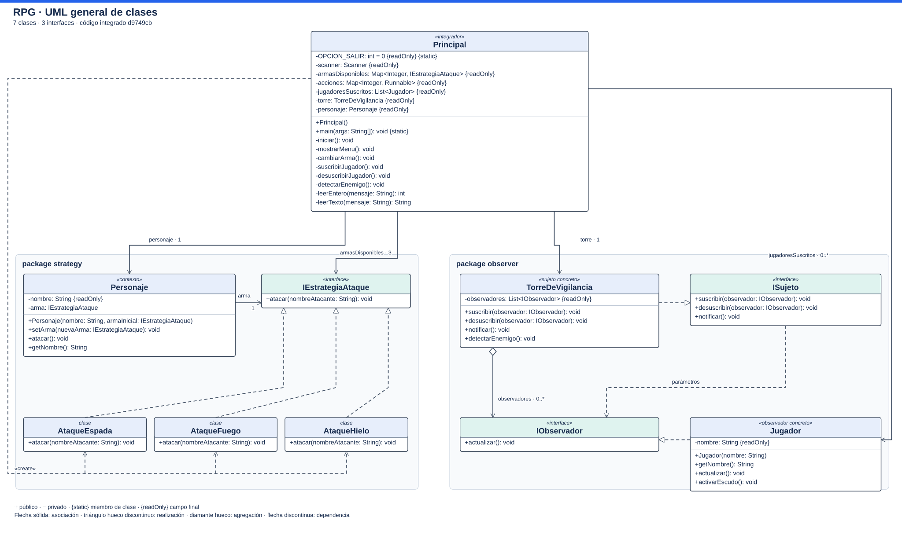
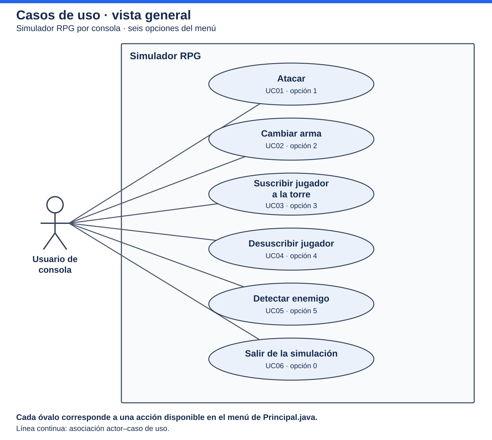
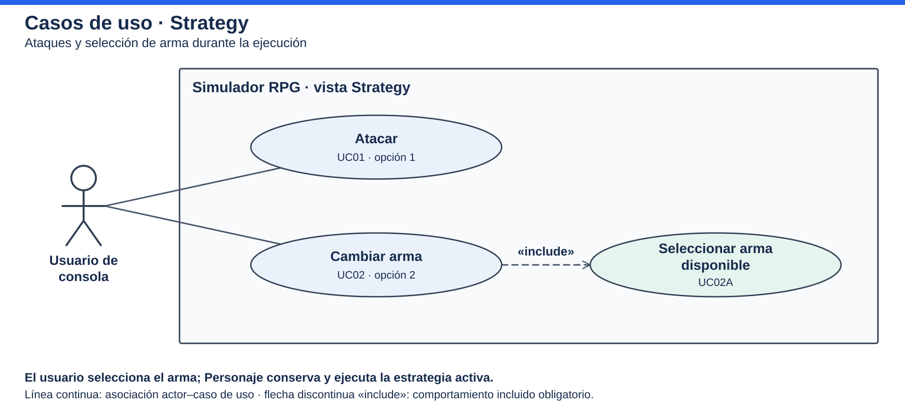
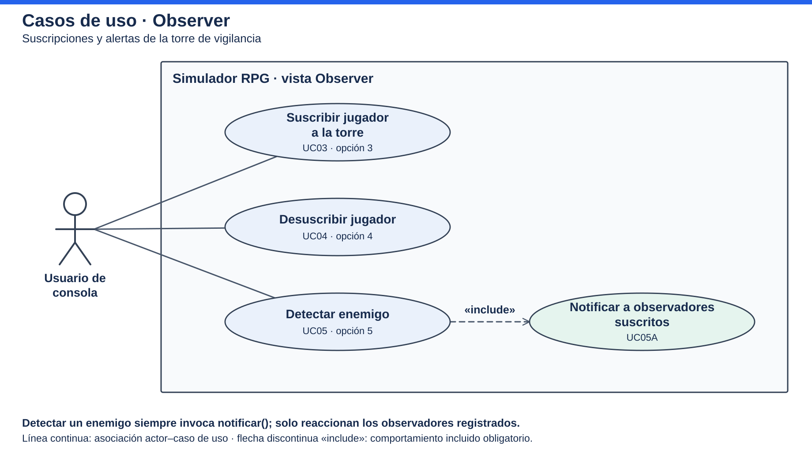

# Diagramas UML del videojuego RPG

## Diagrama general del código

El UML general representa los diez tipos Java declarados en `src`: siete clases y tres interfaces. `Principal` aparece una sola vez con todos sus atributos y métodos explícitos, conectando ambos paquetes. Los archivos `package-info.java` documentan paquetes y no declaran tipos adicionales. Las clases de biblioteca estándar (`Scanner`, `Map`, `List`, `Runnable`, etc.) se muestran en los tipos de los miembros, no como clases propias del proyecto.

| Vista | Imagen SVG | Fuente editable |
|---|---|---|
| General | [general.svg](general.svg) | [general.puml](general.puml) |
| Strategy | [strategy.svg](strategy.svg) | [strategy.puml](strategy.puml) |
| Observer | [observer.svg](observer.svg) | [observer.puml](observer.puml) |

**Legibilidad:** texto de miembros de 24 px y encabezados de 30 px en las imágenes SVG; separación amplia entre cajas, conectores diferenciados y lienzo vectorial ampliable. Las fuentes PlantUML conservan la estructura y ajustes de espaciado, aunque su distribución automática puede variar respecto a los SVG.

## Strategy: diagrama final integrado

Se representan las clases implementadas: `Principal`, `Personaje`, `IEstrategiaAtaque`, `AtaqueEspada`, `AtaqueFuego` y `AtaqueHielo`.

- `Personaje` es el **contexto**; mantiene `arma: IEstrategiaAtaque` y delega `atacar()` mediante `arma.atacar(nombre)`.
- Las tres estrategias concretas **realizan** la interfaz `IEstrategiaAtaque`; la flecha de realización es una línea discontinua con triángulo hueco hacia la interfaz.
- `Principal` contiene `personaje: Personaje`, `armasDisponibles: Map<Integer, IEstrategiaAtaque>` y `acciones: Map<Integer, Runnable>`. Inicializa las tres estrategias concretas en su constructor y cambia el arma a través de `cambiarArma()` y `personaje.setArma(armaElegida)`.
- Las líneas sólidas con navegabilidad representan las **asociaciones** de los campos, no herencia: `Principal → Personaje`, `Principal → IEstrategiaAtaque` a través de los valores del mapa y `Personaje → IEstrategiaAtaque`.

## Observer: diagrama final integrado

Se representan `Principal`, `ISujeto`, `IObservador`, `TorreDeVigilancia` y `Jugador`.

- `TorreDeVigilancia` **realiza** `ISujeto`, mantiene `observadores: List<IObservador>` y conserva una **agregación compartida con 0..* observadores**: guarda referencias sin controlar el ciclo de vida de los observadores.
- `Jugador` **realiza** `IObservador`, define `actualizar()` y en esa operación invoca `activarEscudo()`.
- `ISujeto` **depende de** `IObservador` porque sus métodos de suscripción y desuscripción reciben esa interfaz como parámetro.
- `Principal` mantiene `torre: TorreDeVigilancia` y `jugadoresSuscritos: List<Jugador>`, crea los jugadores, los suscribe o desuscribe, y llama `torre.detectarEnemigo()`.
- Flujo comprobado: `detectarEnemigo() → notificar() → actualizar() → activarEscudo()`. La torre itera sobre una copia temporal de la lista de observadores.

## Verificación frente al código

| Archivo Java en main | Comprobación en los UML |
|---|---|
| [`Principal.java`](../../src/Principal.java) | Instancia `Personaje` y `TorreDeVigilancia`; administra `Map<Integer, IEstrategiaAtaque>`, `Map<Integer, Runnable>` y `List<Jugador>`; métodos de interacción por menú. |
| [`strategy/Personaje.java`](../../src/strategy/Personaje.java) | Constructor, `setArma`, `atacar`, `getNombre` y relación con `IEstrategiaAtaque`. |
| [`strategy/IEstrategiaAtaque.java`](../../src/strategy/IEstrategiaAtaque.java) | Método `atacar(String nombreAtacante)`. |
| [`strategy/AtaqueEspada.java`](../../src/strategy/AtaqueEspada.java), [`AtaqueFuego.java`](../../src/strategy/AtaqueFuego.java) y [`AtaqueHielo.java`](../../src/strategy/AtaqueHielo.java) | Implementaciones concretas y firmas correctas. |
| [`observer/ISujeto.java`](../../src/observer/ISujeto.java) y [`IObservador.java`](../../src/observer/IObservador.java) | Contratos de suscripción/notificación y actualización. |
| [`observer/TorreDeVigilancia.java`](../../src/observer/TorreDeVigilancia.java) | `List<IObservador>`, suscripción, desuscripción, notificación y detección. |
| [`observer/Jugador.java`](../../src/observer/Jugador.java) | `nombre`, constructor, `getNombre()`, `actualizar()` y `activarEscudo()`. |

## Diagramas de casos de uso

**Alcance:** comportamiento funcional del simulador RPG por consola, contrastado con [Principal.java](../../src/Principal.java) de la revisión `d9749cb`. El actor **Usuario de consola** representa a quien introduce las opciones y datos por teclado. `Personaje`, `Jugador` y `TorreDeVigilancia` son objetos internos, no actores externos. El rectángulo delimita el sistema y los óvalos identifican casos de uso.

| Vista | Imagen vectorial | Fuente editable |
|---|---|---|
| General | [casos-uso-general.svg](casos-uso-general.svg) | [PlantUML](casos-uso-general.puml) |
| Strategy | [casos-uso-strategy.svg](casos-uso-strategy.svg) | [PlantUML](casos-uso-strategy.puml) |
| Observer | [casos-uso-observer.svg](casos-uso-observer.svg) | [PlantUML](casos-uso-observer.puml) |

### Vista general

### Strategy

Cambiar arma incluye la selección de una de las armas disponibles. Atacar utiliza el arma activa sin exigir que se cambie antes; la espada es la estrategia inicial. Los tres tipos de ataque son variantes del mismo comportamiento, no actores ni tres opciones independientes del menú principal.

### Observer

Detectar enemigo incluye notificar a los observadores suscritos porque `TorreDeVigilancia.detectarEnemigo()` invoca siempre `notificar()`, incluso con una lista vacía. Cada jugador registrado ejecuta `actualizar()` y después `activarEscudo()`. La detección es iniciada manualmente en el menú; no existe un sensor ni un enemigo externo al sistema.

### Trazabilidad y condiciones

| ID | Caso de uso | Opción | Código relacionado | Resultado o condición |
|---|---|---|---|---|
| UC01 | Atacar | 1 | `personaje::atacar` → `arma.atacar(nombre)` | Muestra el ataque de la estrategia activa. |
| UC02 | Cambiar arma | 2 | `Principal.cambiarArma()` → `Personaje.setArma()` | Sustituye la referencia al arma si es válida; si no, conserva la anterior. |
| UC02A | Seleccionar arma disponible | Incluido en UC02 | `armasDisponibles.get(leerEntero(...))` | Presenta las tres armas (espada, fuego, hielo), lee y valida la selección. |
| UC03 | Suscribir jugador a la torre | 3 | `Principal.suscribirJugador()` → `torre.suscribir(jugador)` | Lee un nombre no vacío, crea el jugador y lo registra. |
| UC04 | Desuscribir jugador | 4 | `Principal.desuscribirJugador()` → `torre.desuscribir(jugador)` | Requiere al menos un jugador y un índice válido; en otro caso, informa y vuelve al menú. |
| UC05 | Detectar enemigo | 5 | `Principal.detectarEnemigo()` → `torre.detectarEnemigo()` | Muestra la alerta e invoca la notificación. |
| UC05A | Notificar a observadores suscritos | Incluido en UC05 | `TorreDeVigilancia.notificar()` → `IObservador.actualizar()` | Notifica de forma síncrona a todos los registrados; si no hay ninguno, no se activa ningún escudo. |
| UC06 | Salir de la simulación | 0 | `Principal.iniciar()` / `OPCION_SALIR` | Finaliza el bucle del menú. |

